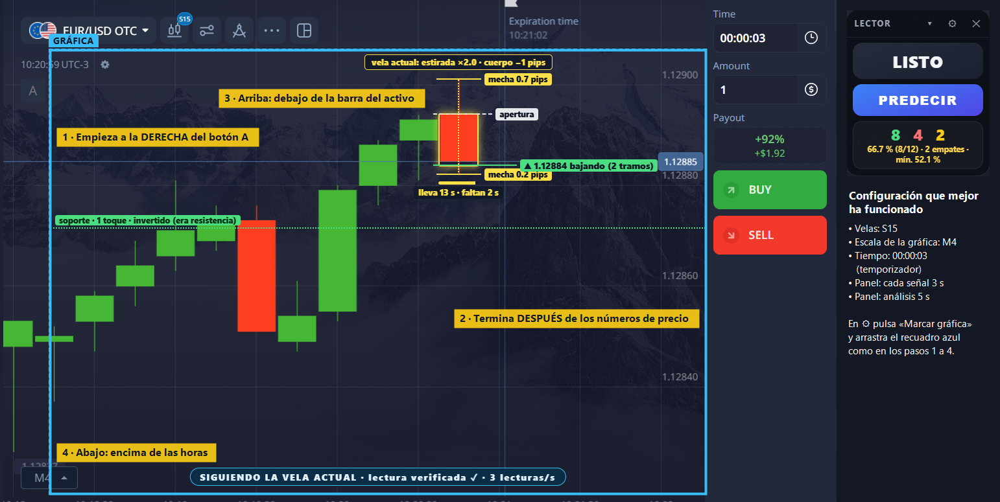

# Lector de tendencia (overlay)

Ventana transparente que queda encima de tu gráfica de velas. Marcas la zona de
la gráfica y el panel:

1. **Lee las velas** que se ven en pantalla (color, cuerpo y mechas).
2. **Muestra una señal** ARRIBA / ABAJO / ESPERAR con reglas de análisis técnico
   (medias móviles de 5 y 10 velas + RSI de 7), como los bots de señales.
3. **Mide la señal**: cada señal se anota y, al cerrar la vela, se registra si
   acertó o falló. El panel muestra el porcentaje real de aciertos, el mínimo
   que hace falta para no perder con el pago de tu plataforma, y cuánto dinero
   llevarías apostando $1 por señal.

Solo muestra información. No hace clic, no apuesta y no se conecta a la plataforma.

## Lo que debes saber antes de usarlo

- **No predice.** La señal describe lo que ya pasó en la gráfica. Sobre precios
  al azar acierta el 50 % (comprobado con 35 000 señales simuladas).
- **Con 50 % de aciertos se pierde.** Si la plataforma paga 85 % al acertar y
  quita el 100 % al fallar, hace falta acertar más del 54 % solo para quedar en cero.
- **Pocas señales no prueban nada.** Rachas de 8 de 10 salen por azar. Por eso
  el panel no da conclusiones con menos de 30 señales.
- Úsalo en **cuenta demo**. El marcador es para que veas con tus propios datos
  si la señal sirve, sin poner dinero.

## Configuración recomendada (versión del 14 de noviembre de 2026)

La que mejor le ha funcionado al autor, en EUR/USD OTC de Pocket Option:

| Dónde | Ajuste |
| --- | --- |
| Gráfica | Velas **S15** (15 segundos) |
| Gráfica | Escala **M4** (botón de abajo a la izquierda) |
| Plataforma | Tiempo **00:00:03** (temporizador de 3 segundos) |
| Panel ⚙ | Cada señal vale **3** segundos |
| Panel ⚙ | Análisis entre señales **5** segundos |
| Panel ⚙ | Pago: el que muestre la plataforma (92 % en la imagen) |

**Cómo marcar la zona de la gráfica** (⚙ → «Marcar gráfica» y arrastrar el recuadro azul):



1. Empieza a la **derecha del botón «A»** de la plataforma (si queda dentro, tapa velas y el
   panel avisa «un aviso de la plataforma tapa velas en medio»).
2. Termina **después de los números de precio** de la derecha: así el panel lee la cotización,
   da las medidas en pips y no deja señales «sin medir».
3. Arriba, por debajo de la barra del activo.
4. Abajo, por encima de las horas.

## Novedades de esta versión

- **Panel compacto**: la señal, su porcentaje de confianza, el botón, la barra y el marcador.
  El detalle (las 8 lecturas, patrón, memoria, marcador de cada IA) se abre con **▾**.
- **Porcentaje de confianza**: debajo de ARRIBA / ABAJO, el acierto *medido* de las señales del
  mismo nivel (alta, media, baja) y del mismo plazo en los últimos 7 días, con «acertó X de N».
  Es lo medido, no una promesa.
- **Zona de entrada**: al salir la señal se dibujan dos líneas, la del *mejor precio* (la orilla)
  y la *límite*; entre las dos está bien entrar. Una raya blanca marca el precio de referencia
  (el de la señal) y dice si va ganando o perdiendo (`src/entry.js`).
- **Soporte y resistencia medidos** con pivotes de las últimas 80 velas, con sus toques y si el
  nivel está *vigente* o *invertido* (`src/levels.js`). Son los mismos que se mandan a las IA.
- **Marcador siempre sobre la vela en curso**, con su reloj («lleva 9 s · faltan 6 s»). Si la
  vela en curso no está a la vista, se oculta y avisa (`src/candleclock.js`).
- **Freno para la IA**: si la vela en curso ya está estirada hacia el lado de la señal (1.5 veces
  lo normal) o ya van 4 velas seguidas de ese color, la señal no se sigue: ESPERAR (o confianza
  baja si está activo «Dar siempre ARRIBA o ABAJO»).
- **Sin predicción, el panel se libera** en 10 segundos como mucho (no espera todo el plazo).
- **Plazos largos**: con «Cada señal vale» en 300 la señal dura 5 minutos exactos (velas M1).
- **Registro de motivos**: en `registro\AAAA-MM-DD.csv` quedan lo que dijo cada IA (`A`), el
  motivo final (`M`) y cómo estaba la vela (`C`), para revisar después por qué salió cada señal.
- **Foto real con el panel**: ⚙ → «Guardar captura» deja `capturas\HHMMSS_pantalla.png`. Las
  capturas normales no ven el panel porque se oculta para no leerse a sí mismo.

## Cómo abrirlo

Doble clic en `iniciar.bat`, o en una terminal dentro de esta carpeta:

```bash
npm start
```

## Cómo usarlo

1. Abre la gráfica en modo **velas** y aleja el zoom hasta ver **30 o más
   velas**. Con menos de 20 el panel avisa: funciona, pero casi no tiene
   historial para saber qué tamaño de vela es normal.
2. Pulsa **Marcar gráfica** y arrastra un recuadro que cubra **toda el área de
   la gráfica**, de arriba abajo: si el precio sube más allá del borde de la
   zona, la vela actual se lee cortada. No incluyas botones verdes o rojos de
   la plataforma (se confundirían con velas).
3. Pon en **Pago de la plataforma** el porcentaje que te muestra como *Payout*
   para ese activo. Cambia mucho: con 85 % hay que acertar más de 54 %; con
   48 % hay que acertar más de 67.6 %.
4. Pon en **Cada señal vale (segundos)** el mismo tiempo que tu expiración.
5. Pulsa **PREDECIR** cuando quieras una señal. El panel analiza, da ARRIBA o
   ABAJO, la califica al terminar el tiempo y vuelve a **LISTO** hasta que
   pulses otra vez. Si prefieres que dé una señal tras otra sin pulsar, activa
   en ⚙ **Predecir solo, sin botón (automático)**.
6. (Opcional) Escribe en ⚙ → **Activo** el par que operas (p. ej. `AED/CNY OTC`).

## Cada cuánto lee la pantalla

Cada **300 milisegundos** (unas 3 lecturas por segundo) lee las velas y la
línea del precio. Guarda las lecturas de los últimos 6 segundos y con las de
los últimos 3 calcula cómo se está moviendo el precio **ahora mismo**
(subiendo, bajando, quieto; "con fuerza" si avanza 3 píxeles o más casi sin
retrocesos). Las lecturas se guardan relativas a las velas, así que siguen
sirviendo aunque la gráfica cambie de escala cuando el precio marca un máximo.

## El panel

Es pequeño a propósito: la señal, una barra, cuatro lecturas (tendencia, vela
actual, precio, RSI) y el contador de ganadas y perdidas. La barra avanza por
pasos mientras analiza y luego muestra el tiempo que falta para calificar la
señal. El engrane **⚙** abre los ajustes: marcar la zona, tiempos, pago y la
clave de la IA.

## Cuando la plataforma tapa la gráfica

Al operar, la plataforma dibuja cosas encima de las velas: la rayita de la
orden abierta ("▲$1"), el globo del resultado ("+$1.65 ✓") sobre la vela
actual y el aviso "Trade closed" sobre las velas de la izquierda.

- La rayita de la orden ya no deforma la vela actual (se ignoran trazos
  separados de la vela por más de 3 px).
- Si un globo tapa la vela actual, o de golpe faltan 3 o más velas, el panel
  muestra un aviso amarillo y **no analiza esa lectura**: espera a que se
  quite. Mientras tanto PREDECIR queda apagado.
- Si la gráfica está tapada justo cuando toca calificar una señal, usa la
  última lectura buena (de hasta 0.7 s antes) o la primera buena (hasta 1.5 s
  después). Si no hay ninguna, la señal queda "sin medir": no se inventa.

La regla para saber si la lectura es buena: la línea del precio tiene que
pasar por el cierre de la última vela leída (a 5 px o menos).

## Por qué tus operaciones pueden ir peor que la señal

"Señal medida con el precio" cuenta desde el instante en que aparece la señal.
Tu operación cuenta desde que haces clic y la plataforma la ejecuta, uno o dos
segundos después, y con otro precio de entrada. Con expiración de 5 segundos
ese retraso es casi la mitad del tiempo. Con 30 o 60 segundos casi no pesa.

## Precio y pips (leer el eje)

Si la zona marcada incluye **los números del eje de precios** (la columna a la
derecha de la gráfica, con el borde derecho de la zona justo después de los
números), el panel los lee y:

- muestra la cotización actual arriba de las lecturas ("Precio 1.20573");
- da las distancias en **pips** ("Mov. 1 min ±5 pips", "Nivel abajo 14 pips")
  en vez de en "velas";
- le pasa la cotización y los pips a la IA.

Cómo lee: compara cada dígito con plantillas de varias tipografías
(`src/digits.json`, generadas con `npx electron tools/build-digits.js`) y solo
acepta la lectura si los números del eje van a pasos iguales. Si no cuadra,
sigue en "velas": prefiere no dar pips a darlos mal. Probado con dos capturas
reales (1.20573 y USD/MXN 18.6455); los dígitos 3, 7 y 9 aún no se han visto
en una captura real del eje.

## Patrón medido (continúa o rebota)

Debajo de las lecturas hay una línea "Patrón medido". El panel corta el precio
de los últimos 30 minutos en tramos del mismo plazo que tu señal y cuenta
cuántas veces el tramo siguiente fue hacia el mismo lado:

- **continúa N %**: el precio viene siguiendo la dirección del tramo anterior.
  La señal sigue el movimiento y ya no apuesta al regreso de velas estiradas.
- **rebota N %**: el precio viene yendo en contra del tramo anterior. La señal
  va contra el último tramo y cuentan las lecturas de regreso (vela estirada,
  agotamiento, RSI extremo, soporte/resistencia).
- **sin patrón claro**: no se distingue del azar; la señal no cambia.

Necesita 60 tramos (5 minutos a 5 s) con la gráfica a la vista y solo declara
un patrón si se aleja de 50 % más de lo que explicaría la suerte. Describe los
últimos minutos: puede cambiar, y no garantiza el siguiente tramo.

## Figuras de varias velas

Además de los patrones de una sola vela, el panel reconoce seis figuras sobre
las velas ya cerradas (`src/formations.js`):

| Figura | Qué es | Voto |
| --- | --- | --- |
| Doble techo / doble piso | El precio llegó dos veces a la misma altura y no la pasó | 2, giro |
| Estrella de la tarde / de la mañana | Vela grande, vela chiquita, vela grande en contra | 2, giro |
| Tres soldados / tres cuervos | Tres velas del mismo color, cada una cerrando más allá | 1, continuación |

La figura aparece en el rótulo de la vela actual ("· figura: estrella de la
tarde"), en la razón de la señal ("Figura: …") y se le manda a las IA. Si el
patrón medido dice que el precio viene continuando, las figuras de giro no
cuentan; si viene rebotando, no cuentan las de continuación.

Lo que mostró la simulación: en los mercados artificiales no cambian el acierto
de la señal (±0.2 puntos). Esos mercados no forman figuras a propósito, así que
no prueba que no sirvan, pero tampoco que sirvan: se inventaron para velas de
horas o días, y en velas de segundos su efecto hay que medirlo con el marcador.

## Simulación

```
node tools/simular.js              mercados artificiales
node tools/simular.js --detalle    con el acierto de cada lectura por separado
node tools/simular.js archivo.csv  precio REAL grabado por el panel
```

Resultado con mercados artificiales (señal a 5 s, ~20 000 casos por fila):

| Mercado | Sin patrón medido | Con patrón medido |
| --- | --- | --- |
| Al azar | 50 % | 50 % |
| Que continúa | 59 % | 70–72 % |
| Que rebota | 46–50 % | 57–63 % |

Lectura honesta: en azar nada pasa de 50 % (así debe ser: es la prueba de que
no hay trampa). La mejora depende de que el precio real tenga un patrón. Los
mercados artificiales no son el mercado real.

**Registro para simular con datos reales:** con el eje a la vista, el panel
guarda cada lectura del precio y cada señal con su resultado en
`%APPDATA%\senales-overlay\registro\AAAA-MM-DD.csv`. Con 20 minutos o más de
registro se puede correr la simulación sobre el precio de verdad.

## Señal al instante (para expiraciones de 5 a 15 segundos)

En ⚙, **Señal al instante al pulsar (sin esperar a la IA)**: al pulsar PREDECIR
la señal sale en ese momento (menos de medio segundo), con las reglas del panel
y el movimiento del precio de ese instante. No hay pausa de análisis ni
consulta a la IA, así que tampoco se cobra nada.

Para qué sirve: la IA tarda 3 a 5 segundos en contestar. En una operación de 5
segundos, su respuesta llega cuando el precio ya se movió.

**Cómo saber cuál conviene:** con la IA activa y esta casilla apagada, el
contador muestra una línea extra, "Reglas al instante: X de N". Es la misma
pulsación medida con la señal que las reglas habrían dado al instante. Si ese
porcentaje es mayor que el de "Señal medida con el precio", activa la casilla.

## Las 8 lecturas

Debajo de la señal hay 8 lecturas con su mini-gráfica. Se calculan con las
velas leídas de la pantalla, **cuentan en la señal** (hasta 2 votos, ver "Los
dos modos") y se le mandan a la IA en números.

| Lectura | Qué dice | ¿Vota? |
| --- | --- | --- |
| **Tendencia** | Hacia dónde van las últimas velas (hasta 60). | Sí |
| **EMA 50/200** | Media rápida contra media lenta. | Sí |
| **Momentum** | Avance del precio en las últimas 5 velas, y cómo va ahora mismo. | Sí |
| **RSI 14** | 70 o más = sobrecompra (vota abajo); 30 o menos = sobreventa (vota arriba). | Solo en extremos |
| **Mov. 1 min** | Cuánto osciló el precio en el último minuto. | No |
| **Nivel abajo** | Soporte más cercano por debajo y cuántas veces se tocó. Pegado al soporte vota arriba; pegado a la resistencia, abajo. | Solo si está cerca |
| **Sesión** | Sesión de mercado por la hora. En OTC no aplica. | No |
| **Resumen** | Cuántas de las 5 lecturas con dirección apuntan a cada lado. | Es el voto total |

Cosas que conviene saber:

- **No hay precios reales**, solo píxeles de la pantalla. Por eso las
  distancias salen en "velas" (1 vela = tamaño típico de una vela de esa
  gráfica) y no en pips.
- **El historial se acumula.** En pantalla caben 20 o 30 velas, pero el panel
  guarda cada vela que cierra mientras está abierto (hasta 400), aunque la
  gráfica cambie de escala. El número de velas guardadas aparece arriba a la
  derecha de las lecturas.
- **EMA 50/200 necesita 200 velas guardadas.** Antes de eso usa el par más
  largo que alcance (5/10, 9/21, 12/50, 25/100) y el nombre de la lectura dice
  cuál. Al marcar otra zona o cambiar de activo el historial empieza de nuevo.
- Más lecturas dan más contexto, no certeza: lo que dice si acierta es el
  contador.

## Versiones guardadas (para volver atrás)

El proyecto lleva control de versiones local (git). Puntos de restauración:

- `version-buena-2026-11-12`: tres IA, escáner con lectura verificada y línea
  de COMPRA / VENTA sugerida. Es la versión que se pidió conservar antes de
  agregar el reloj de la vela y la memoria por momento.

Para volver a ese punto (con el panel cerrado):

```bash
git checkout version-buena-2026-11-12 -- .
```

El registro marca con una línea `V,` el momento en que arranca cada versión,
para comparar el acierto antes y después de un cambio.

## Tres IA a la vez (ChatGPT, Gemini y Claude)

En ⚙ hay tres espacios para claves: **ChatGPT (OpenAI)**, **Gemini (Google)** y
**Claude (Anthropic)**. Se puede usar una, dos o las tres. Cada clave se pega
en su espacio (nunca en un chat), se guarda cifrada en esta computadora y de
ella solo se muestran los últimos 4 caracteres.

- Al pegar una clave el panel le pregunta a ese proveedor qué modelos tiene la
  cuenta y elige uno: en Gemini, el que contenga "argon" en el nombre; en
  Claude, Claude Fable 5.2 (`claude-fable-5-2`). Se puede cambiar en "Modelo".
- En cada predicción todas las IA activas reciben **los mismos números** al
  mismo tiempo y cada una responde ARRIBA o ABAJO.
- **Gana la mayoría.** La razón de la señal empieza con los votos, por ejemplo
  "Astra ▲ · Argon ▼ · Fable ▲". Unánimes = confianza alta; dos contra una =
  la confianza de la mayoría bajada un nivel; empate entre dos = decide la que
  dijo estar más segura (confianza baja), y si empatan del todo, la señal sale
  de las reglas del panel.
- Se espera a que contesten todas, hasta 5 s más que la pausa de análisis; la
  que no llegue a tiempo no vota en esa señal.
- **Cada IA lleva su marcador** ("Astra 7/12 · Argon 6/12 · Fable 8/11"): las
  veces que el precio fue hacia donde ella dijo, aunque la señal mostrada haya
  sido otra. Sirve para ver cuál conviene dejar activa.
- A las tres se les dice que actúen como un trader experto en muy corto plazo
  (velas japonesas, análisis técnico, tendencia y acción del precio), con el
  foco en la vela en curso. Eso orienta cómo analizan; no les da más datos que
  los números que el panel lee de la pantalla.
- Cada predicción se cobra en la cuenta de cada IA activa. Claude Fable 5.2 es
  el más caro de los tres.

Sobre Claude: se usa la librería oficial (`@anthropic-ai/sdk`), con esfuerzo
"low" porque la señal dura segundos, y con el respaldo del servidor activado
(si Claude Fable 5.2 declina una consulta, otro modelo de Claude la contesta
en la misma llamada). La cuenta necesita retención de datos de 30 días.

Tres IA de acuerdo no es una garantía: todas ven los mismos números.

## Memoria: lo que el panel y las IA recuerdan

Las IA no recuerdan nada por sí mismas: cada consulta empieza de cero. La
memoria la lleva el panel y se la manda en cada predicción.

**Memoria del mercado** (línea "Memoria" del panel). Cada vela que cierra se
guarda en disco, en `%APPDATA%\senales-overlay\memoria\<activo>_<segundos>s.csv`,
un archivo por activo y tamaño de vela. Se acumula entre sesiones (hasta 6000
velas, unas 25 horas de velas de 15 s). Con ella el panel responde: "van 3
verdes seguidas; las otras veces que pasó eso aquí, ¿cómo fue la siguiente?".

- Ejemplo: "tras 3 verdes seguidas, la siguiente fue roja 9 de 14 veces (64 %)".
- **Vota en la señal** (1 o 2 votos) solo con 12 casos o más y una diferencia
  que no se explique por suerte. Si no, solo informa ("pocos casos aún" o "sin
  ventaja clara").
- Se le manda a las IA la situación actual y la tabla completa de rachas.
- No cruza huecos: si el panel estuvo cerrado, la racha se corta ahí.
- **Escribe el activo en ⚙** para que cada par tenga su memoria. Si lo dejas
  vacío, todo se guarda junto como "sin-nombre" y se mezclan pares distintos.
- Al principio está vacía: con velas de 15 s junta unas 240 por hora. Empieza a
  servir tras una o dos horas en el mismo par.

**Memoria por momento de la vela** (desde el 2026-11-12). Cada vela se parte en
tramos del tamaño de la operación (vela de 15 s y operaciones de 5 s = 3
tramos) y se guarda hacia dónde fue el precio en cada tramo. Así la memoria
puede decir: "tras 2 verdes seguidas, en el tramo 2 de 3 de la vela el precio
bajó 11 de 16 veces". El tramo se elige según cuándo empezará de verdad la
operación (ahora + lo que tardan las IA + tu retraso de entrada); si para
entonces la vela ya habrá cerrado, se usa el primer tramo de la siguiente.
Mismas reglas para votar (12 casos y diferencia clara); el voto de la memoria
nunca pasa de 2. Las velas guardadas antes de este cambio no tienen tramos.

**Reloj de la vela para las IA.** En cada consulta se les manda cuánto lleva la
vela, cuánto dura y cuánto le falta, con la instrucción de que, si su respuesta
tarda más que eso, razonen sobre el arranque de la vela siguiente.

**Memoria de cada IA.** En cada consulta, cada IA recibe sus últimas 10
predicciones en esa gráfica con lo que pasó ("dijiste que subiría, bajó") y su
cuenta de aciertos, para que pueda corregirse. Se borra al pulsar Reiniciar o
marcar otra zona.

## Escáner, costo por predicción y retraso de entrada

**Escáner (lectura verificada).** Mientras analiza, un haz recorre la zona de
izquierda (velas viejas) a derecha (vela actual). No es solo adorno:

- **Lectura verificada:** el panel compara tres lecturas seguidas de las velas
  (mismo número y, una por una, mismo color y misma forma). Solo con las tres
  iguales da la lectura por buena; si una sale rara (un destello, algo que
  pasa por encima, una vela a medio tapar) usa las últimas velas buenas. El
  rótulo dice "lectura verificada ✓" o "verificando lectura…".
- **Lo que leyó, a la vista:** dibuja un recuadro por cada vela reconocida, la
  vela actual en amarillo, y las líneas de soporte (verde) y resistencia
  (roja). Si un recuadro no coincide con una vela, la zona está mal marcada o
  el zoom no sirve.
- Mientras el escáner se ve, la ventana del panel se oculta a las capturas de
  pantalla (`setContentProtection`) para que nada de lo dibujado se cuele en la
  lectura. Una captura hecha en ese instante sale sin el panel.

**Seguimiento de la vela actual.** Durante el análisis y durante la señal, la
vela en curso lleva un seguimiento propio: recuadro exacto sobre el cuerpo
(error medido menor a 1 px), línea punteada de las mechas con sus extremos y
tamaño en pips, raya de apertura, marcador del precio en vivo con flecha de
hacia dónde se mueve, rótulo con el patrón de la vela y el tamaño del cuerpo,
y un reloj con lo que lleva la vela. Mientras se escanea, la pantalla se lee
sin pausas (unas 5 veces por segundo en lugar de 3).

**Línea de COMPRA / VENTA sugerida.** En cuanto sale la predicción se dibuja
una línea sobre la gráfica en el precio de ese instante: verde con el rótulo
"COMPRA ▲ sugerida · 1.20170", o roja con "VENTA ▼ sugerida". Una franja
difuminada marca hacia dónde tiene que irse el precio para que la operación
gane (arriba de la línea en compra, abajo en venta). Si la señal es de
confianza baja, la línea es punteada y el rótulo lo dice.

Cuando llega tu momento de entrada (la señal más tu retraso al hacer clic), la
línea pasa a ese precio y el rótulo añade en vivo "va ganando +0.8 pips" o "va
perdiendo −0.5 pips". Con el eje de precios dentro de la zona muestra la
cotización y los pips; sin el eje, la línea se queda en la fila del precio de
la señal, sin números.

Es la sugerencia del panel, igual que el ARRIBA / ABAJO de la caja: el panel
no hace clic ni opera.

**Costo por predicción.** Cada proveedor informa en su respuesta los tokens que
cobró (los de "pensamiento" cuentan como salida). El panel los suma y muestra,
debajo del contador, "Por predicción: Astra $0.06 (3.9 s) · Argon 0.9 ¢ (2.1 s)
· Fable $0.04 (4.2 s)": costo aproximado y segundos que tarda cada una. En ⚙,
cada IA muestra sus consultas y tokens acumulados. Los tokens son exactos; el
precio es una referencia (`src/prices.js`) y puede no coincidir con la factura.
También queda en el registro (líneas `U,`).

**Retraso de entrada.** La orden no entra en el instante en que aparece la
señal, sino cuando haces clic. El panel lo mide solo: compara cuándo apareció
la señal con cuándo la plataforma muestra el globo del resultado. Con 3 o más
operaciones, la señal pasa a medirse **desde tu entrada** ("Señal medida
entrando a los 2.1 s") y a las IA se les dice que predigan ese tramo. Así el
porcentaje del panel mide lo mismo que tus operaciones.

## Medición con la cotización real

Con el eje de precios dentro de la zona, las señales se califican con la
**cotización real** (la etiqueta azul del precio en el eje), no con las velas.
Por eso un globo de resultado, el aviso "Trade closed" o la marca de una
operación abierta ya no dejan señales "sin medir" ni apagan PREDECIR: el precio
se sigue leyendo aunque algo tape las velas. Si lo tapado es la vela en curso,
su patrón no vota en esa señal y lo demás sigue igual.

Sin el eje a la vista se mide respecto a las velas, y entonces sí hay que
esperar a que se destapen.

## Inteligencia artificial (opcional)

En **⚙** puedes pegar una clave de la API de OpenAI (ChatGPT). Se consigue en
<https://platform.openai.com/api-keys>; el botón **Conseguir una clave** abre
esa página.

- En cada predicción el panel le manda a OpenAI **solo números**: las últimas
  24 velas, las 8 lecturas (calculadas con todo el historial guardado), los
  últimos movimientos del precio, el recorrido del precio lectura a lectura de
  los últimos segundos y el nombre del activo. La respuesta
  (ARRIBA, ABAJO o esperar, con su razón) se usa como señal y se marca "IA".
- Con el botón **PREDECIR** la consulta sale al pulsar y la señal aparece en
  cuanto la IA contesta (se la espera hasta 5 s más que la pausa de análisis).
  Mientras nadie pulsa no se consulta ni se cobra nada.
- Si no hay clave, falla o tarda demasiado, esa señal sale de las reglas del
  panel y se marca "reglas".
- **El activo es solo contexto.** La IA no busca noticias ni datos externos: en
  5 segundos no influyen, y los pares **OTC** son una cotización propia del
  bróker que no sigue al mercado real, así que no hay dato externo que aplique.
- En **⚙ → Modelo** se elige entre los modelos de chat que tu cuenta tiene. El
  modelo debe contestar antes de que toque dar la señal: la consulta sale 2.5 s
  antes de que termine la señal en curso, así que dispone de esos segundos más
  la pausa de análisis. Tiempos medidos el 2026-11-11: `gpt-6-sol` ~2 s,
  `gpt-6.1-terra` y `gpt-5.5` ~3 s, `gpt-6-astra` 3 a 5 s, `gpt-5-mini` 8 a 9 s
  (este último no alcanza con pausas cortas).
- La clave se guarda cifrada en esta computadora y nunca se muestra completa.
- Cada señal es una consulta que **se cobra a tu cuenta de OpenAI**. La API se
  paga aparte de la suscripción de ChatGPT: necesita saldo en
  platform.openai.com. Necesita una pausa de análisis de 3 s o más.
- Una IA describe patrones mejor que unas reglas fijas, pero eso no la vuelve
  adivina. Su señal se mide con los mismos contadores: ahí se ve si acierta más.

## Los dos marcadores

- **Tus operaciones**: cuenta el resultado que la propia plataforma dibuja sobre
  la gráfica al cerrar cada operación: globo con círculo **verde = ganada**,
  **rojo = perdida**. Es el resultado real de lo que operaste (en demo o real).
  Cada globo se cuenta una sola vez; los que ya estaban en pantalla al abrir o
  al marcar la zona no cuentan. Solo suma si tú haces operaciones.
- **La señal, medida con el precio**: califica cada señal del panel mirando si
  el precio subió o bajó, operes o no.

Los dos usan el pago que escribas para calcular el mínimo necesario.

## Los dos modos

- **Por segundos** (por defecto, 5): el panel da una señal, anota dónde está la
  línea del precio, espera esos segundos, mira si el precio quedó arriba o
  abajo, la califica y da la siguiente. Funciona con velas de cualquier tamaño.
  La línea horizontal del precio actual debe quedar dentro de la zona marcada.
  Entre una señal y la siguiente hay una **pausa de análisis** (5 s por
  defecto) en la que el panel dice ANALIZANDO y solo observa el precio; nunca
  da dos señales pegadas.

  La señal es una votación que trata igual subidas y bajadas. **Lo más
  reciente pesa más**:
  - **Precio ahora mismo**: cómo se mueve lectura a lectura en los últimos 3
    segundos (1 voto; 2 si va con fuerza).
  - **Vela actual**: su patrón. Cuerpo fuerte empuja en su dirección; mecha
    larga arriba es rechazo (hacia abajo); mecha larga abajo es rebote (hacia
    arriba); envolvente; cuerpo mínimo es indecisión (2 votos o ninguno).
  - **Precio por tramos**: hacia dónde se movió en los últimos tramos (1 voto;
    2 si lleva dos o más seguidos).
  - **Velas anteriores**: hacia dónde van las últimas 4 (1 voto).
  - **Las 8 lecturas**: 1 voto si la mayoría apunta a un lado, 2 si la
    diferencia es de tres o más.

  Hacen falta al menos dos votos netos hacia el mismo lado; si no, ESPERAR. Con
  cuatro o más la confianza es "alta". El panel muestra las lecturas debajo de
  la señal, en vivo aunque no haya señal en curso.

  **Dar siempre ARRIBA o ABAJO** (activado por defecto; se cambia en ⚙): el
  panel nunca dice ESPERAR. Cuando no hay dos votos, o la IA no ve nada claro,
  elige igual el lado más probable y lo marca **confianza baja** (la señal se
  ve rayada y dice "· baja"). Esas señales son casi un volado: dan más
  operaciones, no más aciertos. Con la casilla desactivada vuelve a decir
  ESPERAR en esos casos.

  **Sigue la vela y detecta el pico**: que el precio venga subiendo no quiere
  decir que siga. El panel mira lectura a lectura si el precio marcó un máximo
  y ya devolvió al menos un 35 % de lo subido ("giró hacia abajo desde el
  pico"; lo mismo al revés desde un piso), o si avanzó y se quedó sin fuerza.
  Un giro vale hasta 2 votos hacia el regreso. Si además la vela ya estaba
  estirada es **agotamiento** (2 votos más) y la señal va hacia el regreso con
  confianza normal. En las 8 lecturas también cuentan en contra una racha de 4
  o más velas del mismo color y el precio en el máximo o mínimo de lo visto con
  RSI alto o bajo.

  Con IA: si al llegar su respuesta el precio va con fuerza en contra de lo que
  dijo, la señal se marca "baja" y avisa "Ojo: ahora mismo el precio va en
  contra".

  **No persigue velas estiradas**: si el cuerpo de la vela en curso ya es 1.5
  veces o más el cuerpo normal de las velas anteriores, no da señal a su favor
  (el movimiento ya ocurrió). Sí puede dar señal en contra si el precio se está
  dando la vuelta con fuerza en ese momento. Para saber qué es "normal" necesita al menos 4 velas
  anteriores; con 15 o 20 en pantalla funciona mejor.
- **Por vela** (escribe 0): una señal por cada vela que cierra; se califica con
  el color de la vela siguiente.

Cambiar de modo o de zona pone el marcador en cero, porque las señales de un
modo no se pueden comparar con las del otro.

Si haces zoom, cambias de activo o la gráfica cambia de escala, esa señal no se
califica y el panel se vuelve a sincronizar solo.

## Qué sabe y qué no sabe

Solo sabe lo que hay en la pantalla dentro de la zona marcada: la forma de las
velas visibles. No conoce el precio real, el volumen, noticias ni el historial
que quedó fuera de la pantalla.

## Pruebas

```bash
npm test   # lector de velas (sobre una captura real), señal y marcador
```

## Archivos

- `main.js`: ventana, escaneo y estado.
- `src/candles.js`: imagen de la gráfica → velas.
- `src/signal.js`: medias móviles, RSI y regla de la señal.
- `src/timed.js`: modo por segundos (señal, espera, califica con la línea de precio).
- `src/tracker.js`: modo por vela (detecta el cierre de cada vela y la califica una sola vez).
- `src/ai.js`: consulta opcional a la API de OpenAI (solo números de velas).
- `src/badges.js`: localiza los globos verde/rojo de la plataforma y cuenta cada uno una vez.
- `src/score.js`: porcentaje de aciertos, mínimo necesario, dinero simulado y veredicto.
- `src/capture.js`: captura de pantalla y recorte de la zona.
- `renderer/`: el panel.
- `test/grafica.html` y `test/gen.js`: gráfica de ejemplo para pruebas.
