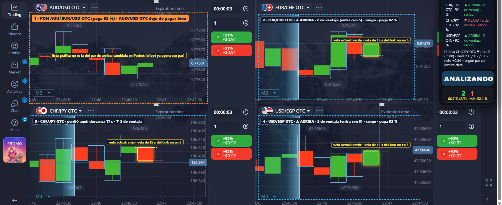
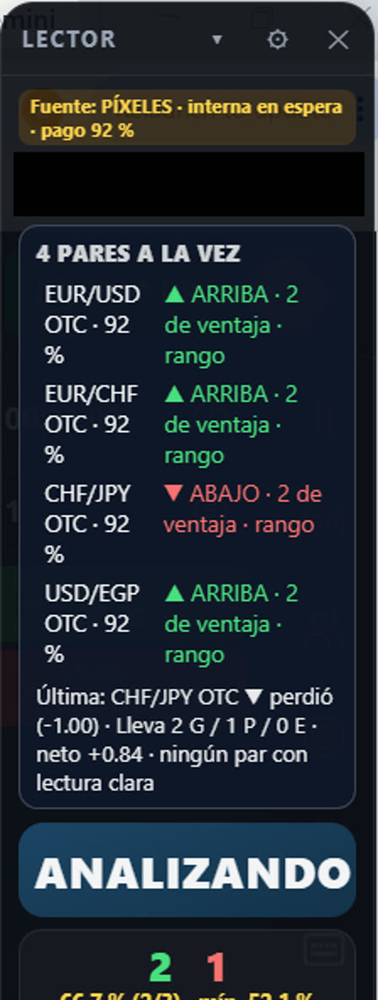
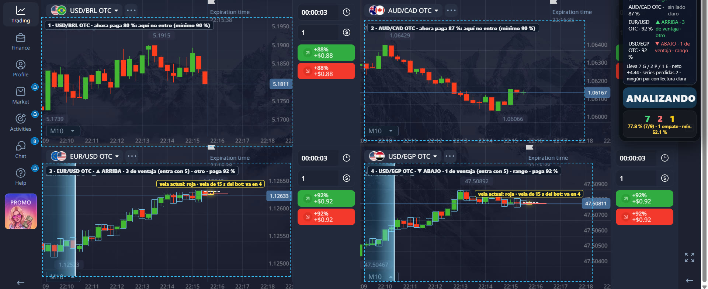
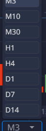
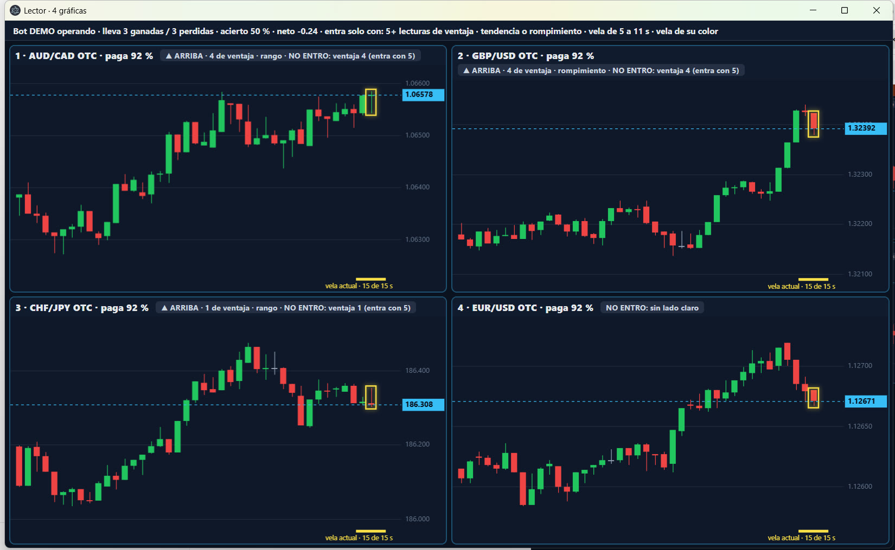

# Instrucciones para Muse — Pocket Option con 4 gráficas

Estado al 16 de noviembre de 2026, 21:15. Todo es **cuenta DEMO**. Rama: `principal` (es la única).

## La versión que se usa

**Las gráficas son las de Pocket Option.** El sistema escoge el par de cada una de las 4 gráficas y **dice cuál poner**; quien maneja la pantalla (el dueño, o Muse) cambia la gráfica en Pocket y la deja en **S15** y **M10**. El bot opera solo sobre esos pares.

Este documento tiene dos partes:

- **Parte A — lo que hay que hacer en la pantalla**: mantener las 4 gráficas de Pocket en los pares que el sistema pide, en velas **S15** y vista **M10**. Esto es lo que hace Muse.
- **Parte B — para más adelante**: lo que habría que programar si se quiere que el sistema cambie las gráficas de Pocket él mismo.

---

## Qué quiere el dueño

1. Ver **4 gráficas de Pocket Option a la vez**, con el escáner del panel encima de cada una. El bot analiza las cuatro y entra en la que tenga la mejor señal.
2. Que el sistema **diga por cuál par irse**: el pago de un par cambia en minutos (se vio 92 % → 40 % en menos de media hora). Cuando un par deja de pagar 90 %, el sistema escoge otro y lo pide con un letrero naranja sobre esa gráfica.
3. Cada gráfica siempre en **velas de 15 segundos (S15)** y **vista M10**.
4. Que **no deje de funcionar**.

---

## Cómo se ve (fotos)

Las fotos están en la carpeta [`fotos/`](fotos). Son recortes de la pantalla del dueño: se quitaron las pestañas del navegador, el saldo y la foto de perfil.

### 1. Pocket con las 4 gráficas y sus marcos — así debe quedar

- Cada gráfica tiene su marco punteado azul y un letrero arriba con su número, su par y lo que lee el panel.
- La gráfica 1 está en **naranja**: dice `PON AQUÍ EUR/USD OTC`. El panel cambió el par de ese lugar porque AUD/USD dejó de pagar bien, y la gráfica de Pocket todavía muestra el par viejo. **Eso es lo que hay que corregir**: cambiar esa gráfica al par que pide.
- El recuadro amarillo marca la vela que va en curso, con su letrero «vela actual».
- La gráfica 3 dice «perdió aquí: descansa 17 s»: el bot no repite en un par donde acaba de perder.

### 2. El panel

Lista de los 4 pares con lo que paga cada uno y hacia dónde apunta, el estado del bot y el marcador de ganadas y perdidas.

### 3. Vista M10 con velas de 15 segundos

Así se ven las gráficas con la vista en **M10** (abajo a la izquierda de cada una). Las gráficas 1 y 2 dicen «ahora paga 80 %: aquí no entro»: son pares que bajaron de pago y hay que cambiarlos.

### 4. El selector de la vista

Es el menú de abajo a la izquierda de cada gráfica. Aquí se escoge **M10**. Ojo: este menú no cambia el tamaño de la vela; eso va en el menú de tipo de gráfica (ver A3).

### 5. La ventana «Lector · 4 gráficas» (apagada; no es la que se usa)

Gráficas que dibuja el propio panel con las velas del bot. Viene **apagada**: el dueño prefiere las gráficas de Pocket con sus marcos. Se puede encender en ⚙ («Usar las 4 gráficas del panel») solo como referencia; mientras está abierta no hay marcos sobre Pocket.

---

## Parte A — Lo que hay que hacer en la pantalla

### A1. Qué pares poner

El sistema decide los cuatro pares y escoge otro cuando uno paga menos de 90 %. Dónde se lee cuál poner:

- **Sobre la gráfica de Pocket:** el marco de esa gráfica se pone **naranja** y dice `PON AQUÍ <par>`. Esa es la señal de que hay que cambiarla (foto 1).
- **En el panel LECTOR** (arriba a la derecha): el cuadro «4 PARES A LA VEZ» lista los cuatro pares en orden, con lo que paga cada uno.
- En ⚙ del panel, cada renglón «Marcar gráfica N» muestra el par de ese lugar.

Cuando la gráfica ya muestra el par pedido, el marco vuelve a azul y el escáner sigue la vela actual.

Regla: la gráfica 1 de Pocket lleva el par del lugar 1, la 2 el del lugar 2, y así. Arriba a la izquierda va la 1, arriba a la derecha la 2, abajo a la izquierda la 3 y abajo a la derecha la 4.

### A2. Cómo cambiar el par de una gráfica en Pocket

1. Clic en el nombre del par, arriba a la izquierda de esa gráfica (por ejemplo `EUR/USD OTC ▾`).
2. Se abre la lista de activos. Escribir el par en el buscador o elegirlo en «Currencies».
3. Clic en el par. La gráfica cambia.

### A3. Cómo dejar una gráfica en S15 y M10

Son dos controles distintos. Confundirlos fue un error que ya costó tiempo:

| Qué | Dónde está | Qué elegir |
|---|---|---|
| **Tamaño de la vela** | Botón de tipo de gráfica, junto al nombre del par (icono de velas). Abre un menú con «Chart types» y «Time frames». | «Candles» y después **S15** |
| **Cuánto tiempo se ve** | Selector de abajo a la izquierda de la gráfica (dice M3, M10, M30, H1…). | **M10** |

Orden que funciona: primero la vista **M10**, después **S15**. Al revés, una vez la página cambió sola las velas a S10. Al terminar, junto al nombre del par debe leerse `S15`.

### A4. Lo que NO se toca

- **No pulsar los botones verde y rojo de compra y venta.** El bot abre sus operaciones por su propio canal; un clic ahí es una operación a mano.
- **No cambiar el monto ni el tiempo** de los recuadros de Pocket: el bot manda los suyos ($1, 3 segundos).
- **No recargar la página de Pocket muchas veces** (ver «El bloqueo», abajo).
- **Solo cuenta DEMO.** Arriba debe decir «QT Demo».

---

## Parte B — Para más adelante: que el sistema cambie las gráficas él mismo

Hoy el cambio de par en Pocket lo hace quien maneja la pantalla (Parte A). Esto es lo que habría que programar para que lo haga el sistema.

### B1. La idea

El bot ya tiene una ventana propia donde abre la página oficial de Pocket con la sesión del dueño. Hoy esa ventana sirve solo para iniciar sesión y se cierra sola. Hay que ampliarla para que:

1. **Se quede abierta** en la sala DEMO, con la vista de 4 gráficas.
2. El panel le **cambie el par de cada gráfica** cuando cambie el par de ese lugar.
3. Deje cada gráfica en **S15 y M10**, y lo vuelva a poner si se pierde.
4. Los marcos del escáner se pongan solos sobre cada gráfica (hoy se marcan a mano en ⚙).

Con eso las operaciones del bot se ven en las gráficas reales de Pocket, porque es la misma cuenta.

### B2. Con qué se cuenta

**La ventana del bot** (código fuera de este repositorio, en el proyecto del bot, módulo `pocket_tyl/capturar_ssid.py`):

- Ventana de Python (PySide6, QtWebEngine) con perfil persistente: recuerda la sesión.
- Expone un puerto local de control (DevTools, CDP) en `127.0.0.1:9333`. Se comprobó que por ahí se listan sus páginas, así que se puede manejar la página con `Runtime.evaluate`.
- Hoy se cierra 6 segundos después de capturar la sesión. Eso es lo primero que hay que cambiar (dejarla abierta en un modo «gráficas»).

**Lo medido de la página de Pocket** (16 nov, en la terminal de prueba pública `…/cabinet/try-demo/`, que usa la misma interfaz):

| Para | Cómo |
|---|---|
| Saber qué par muestra | texto de `.current-symbol` |
| Abrir el menú de tipo de gráfica | `document.querySelector('.items__link--chart-type').click()` |
| Elegir velas | dentro de `.drop-down-modal--chart-type`, el `li` de `.chart-list-block` con texto «Candles» (su `a`) |
| Elegir S15 | dentro del mismo menú, el `li` de `.time-frames-block` con texto `S15`. Solo aparece después de elegir velas |
| Cerrar el menú | mandar `pointerdown`, `mousedown`, `pointerup`, `mouseup` y `click` a `.drop-down-modal-wrap`. Un `click()` solo o la tecla Esc no lo cierran |
| Vista M10 | `select` dentro de `.zoom-controls`: poner el `value` de la opción cuyo texto es `M10` y lanzar un evento `change` con `bubbles: true` |
| Saber si quedó en S15 | el texto de `.top-left-block` contiene `S15` |
| Par cerrado | capa `.asset-inactive` visible con texto |
| Aviso de bienvenida | cerrar con `.tutorial-v1__close-icon.js-exit` |
| Tamaño mínimo | la página no se encoge por debajo de unos 1150 × 700; en un recuadro más chico la gráfica se sale |

El tipo de gráfica y la temporalidad **no se guardan**: al recargar vuelve a gráfica de línea. El guion tiene que poder correr las veces que haga falta y no tocar nada si ya está bien (se probó así y converge en dos pasadas).

**Lo que NO se sabe todavía** y hay que mirar con la página de la cuenta abierta:

- Cómo se cambia el par en la vista de 4 gráficas de la cuenta. En la terminal de prueba el par se cambia con `localStorage.setItem('po-td-asset', 'EURUSD_otc')` y recargando, pero eso es solo de la terminal de prueba. En la cuenta hay que usar la lista de activos (A2) por programa.
- Cómo se enciende la vista de 4 gráficas. En la página existe `#js-window-layout-switcher`; en la terminal de prueba está vacío.
- Los selectores de cada una de las cuatro gráficas (cada una es un `.chart-item` con su propio `.top-left-block`, su botón de tipo y su `.zoom-controls`).

No programar esto a ciegas: primero abrir la página, mirar el DOM y anotar los selectores.

### B3. Lo que ya está hecho en este repositorio

| Pieza | Archivo | Qué hace |
|---|---|---|
| Motor de varios pares | `src/multi.js` | Lee 4 pares con las velas del bot, escoge el mejor, una operación a la vez, no se aferra al par donde pierde, reglas de entrada (`blockReason`) |
| Cambio de pares solo | `src/autopairs.js` | Un par que paga menos del mínimo durante 20 s se cambia por el mejor pagado que no esté en uso |
| Vela actual en cada gráfica | `src/zonetrack.js` | Casa las velas vistas en pantalla con las del bot y ubica la vela en curso |
| Gráficas propias (apagadas) | `renderer/wall.html`, `wall.js`, `wall.css`, `wallmath.js` | Ventana «Lector · 4 gráficas»: el panel dibuja las gráficas con las velas del bot. Ajuste `multiWall`, apagado por defecto |
| Pruebas | `test/multi.test.js`, `autopairs.test.js`, `zonetrack.test.js`, `wallmath.test.js` | 365 pruebas en total: `npm test` |

Ajustes (en `config.json` de la carpeta de datos del panel): `multi`, `multiPairs` (4 lugares), `multiZones`, `multiMinMargin` (5), `multiMinPayout` (90), `multiAuto`, `multiWall`, `multiOnly` (`tendencia`, `rompimiento`), `multiMinAge` (5), `multiMaxAge` (11), `multiSameColor`.

Registro del día (líneas `Q`): `lectura`, `entrada`, `abierta`, `resultado`, `serie`, `par` (con `auto` cuando el cambio fue automático), `reinicio`, `graficas`.

**El bot** (proceso aparte, no está en este repositorio) atiende en `127.0.0.1` con una clave que deja en su carpeta de datos:

| Ruta | Devuelve |
|---|---|
| `GET /estado` | conectado, si es DEMO, saldo |
| `GET /precios` | `[símbolo, nombre, precio, edad s, pago, tipo]` de cada activo que sigue |
| `GET /velas?pares=A,B,C,D` | por par: `[símbolo, nombre, pago, velas cerradas [o,h,l,c], vela en curso, edad s, segundos abierta]` |
| `POST /orden` | `{ asset, dir: 'up'|'down', seconds, level }` → abre la operación en la DEMO |
| `GET /resultado?id=` | resultado y neto de esa operación |

### B4. Cómo se sabe que quedó bien

1. Con el panel y el bot abiertos, la ventana de Pocket del bot muestra 4 gráficas con los pares de `multiPairs`, en ese orden.
2. Al cambiar un par (a mano en ⚙, o solo por bajar de pago), la gráfica de ese lugar cambia en menos de 15 segundos sin tocar nada.
3. Las cuatro dicen `S15` y la vista es M10. Si se cambia una a mano, vuelve sola.
4. El marco del escáner de cada gráfica cae sobre sus velas y el recuadro amarillo sigue la vela en curso.
5. Una operación del bot se ve marcada en la gráfica de su par.
6. En una hora de prueba no hay más de una carga de la página por gráfica.

---

## El bloqueo (leer antes de abrir páginas)

El 16 de noviembre se abrieron cuatro terminales de Pocket a la vez, con recargas, más unos 25 reinicios del panel en el día. A los pocos minutos **el sitio dejó de aceptar conexiones desde ese equipo** (`ERR_CONNECTION_TIMED_OUT`), mientras desde otros países respondía normal. El bot siguió operando porque usa otro canal.

Reglas a partir de eso:

- **Una sola página de Pocket** abierta por el sistema, no cuatro.
- **No recargar para cambiar de par** si se puede hacer con clics dentro de la página.
- Si una carga falla, **esperar** 1, 5, 15 y 60 minutos antes de cada reintento. Nada de reintentos seguidos.
- No usar VPN ni otro truco para saltarse el bloqueo. Se espera a que se quite.

## Reglas de trabajo que no se rompen

- **Solo DEMO.** El sistema se niega a operar en cuenta real y así debe seguir.
- **La contraseña la escribe el dueño**, nadie más, y no se guarda.
- Antes de reiniciar el panel: `node --check main.js` y `npm test`. Esa noche un cambio sin revisar dejó el panel con un error en pantalla.
- Los cambios al panel se prueban primero con datos de ejemplo (`renderer/wall_demo.html`), no en la sesión del dueño.
- El repositorio es **público**: no subir capturas de pantalla, saldos, claves ni datos de la cuenta. La carpeta `capturas/` está excluida.

## Cómo va el acierto (para no prometer de más)

- Reglas de entrada actuales: 5 o más lecturas de ventaja, solo jugadas de tendencia o rompimiento, vela en curso con 5 a 11 segundos abierta y del color de la entrada. Sin martingala, $1 fijo.
- Hoy en vivo, antes de estas reglas: 635 entradas, 50 % de acierto. Con 5 lecturas de ventaja: 53.7 % de 188. De esas, tendencia y rompimiento: 57.6 % de 125.
- Las mismas reglas sobre lo grabado ese día (112 pares, unas 16,000 jugadas): 49.4 a 50.3 %.
- Con pago de 92 % hace falta 52.1 % para no perder.
- Plan de medición: 200 entradas con las reglas nuevas. A las 100, descartar si hay 48 ganadas o menos. A las 200, seguir con 112 o más; descartar con 105 o menos.
